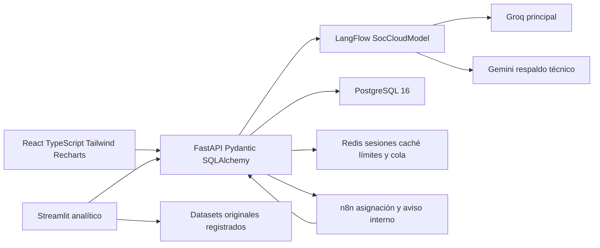

# Fase 0 Preparación e integración del entorno analítico SOC

Actualización de alineación del 10/11/2026: la fuente principal es ahora `ARCHIVO_SPEC_SOC_Caso06_Concordante_Groq_Gemini.docx`, versión 2.1. La matriz, correcciones y comprobaciones posteriores están en [ALINEACION_SPEC_FASE_0.md](ALINEACION_SPEC_FASE_0.md). Los resultados de la entrega inicial consignados más abajo se conservan como evidencia histórica y no sustituyen esta validación posterior.

## Alcance y decisiones

Esta fase incorpora Streamlit al sistema existente como cliente adicional de FastAPI. React conserva la operación diaria. Los nuevos módulos consultan los servicios y archivos originales y no ejecutan entrenamiento, evaluación predictiva, explicaciones de modelos ni búsqueda de hiperparámetros.

SUPUESTOS adoptados: Streamlit se ejecuta en la misma computadora que el proyecto y se publica únicamente en loopback; sus usuarios usan las cuentas, JWT, segundo factor y permisos del backend. Los archivos públicos locales se consultan tras autenticar al usuario con permiso `read`. Publicar esta interfaz en otra máquina requiere revisar autenticación, transporte HTTPS y acceso a los archivos. La semilla numérica no convierte un servicio LLM externo en determinista.

Las precisiones del usuario prevalecen sobre las propuestas del documento ARCHIVO_SPEC: Groq es principal, Gemini es respaldo, y los datasets originales ya existen. DeepSeek pertenece al entorno del agente de desarrollo. El dominio es texto de reportes SOC.

## Arquitectura existente



| Carpeta o archivo | Responsabilidad existente |
| --- | --- |
| `backend/main.py` | Recepción, clasificación mediante LangFlow, persistencia, despacho n8n y salud |
| `backend/classifier.py` | Taxonomía, validación estricta de salida, confianza y revisión |
| `backend/chat.py` | Chat con clientes HTTP de Groq y Gemini |
| `backend/security.py`, `backend/totp.py` | JWT, sesiones, RBAC, contraseñas y segundo factor |
| `backend/routing.py`, `integrations/reglas.json` | Reglas determinísticas y configuración versionada |
| `backend/operations.py` | Activos, equipos, revisión humana, colaboración y notificaciones |
| `backend/db.py`, `db/schema.sql` | PostgreSQL, modo SQLite aislado, auditoría y esquema |
| `backend/insights.py`, `backend/impact_study.py`, `backend/exports.py` | Indicadores, estudios operativos y exportación |
| `frontend/src/` | Interfaz operacional React |
| `integrations/langflow/` | Prompt, componente cloud y export histórico del flujo |
| `integrations/n8n/assign_report.json` | Webhook autenticado, reglas, asignación y aviso |
| `scripts/vcdb.py`, `scripts/vcdb_review.py`, `scripts/soc_dataset*.py` | Preparación y evaluación previa con VCDB |
| `compose.yaml`, `Start-Soc.ps1`, `Stop-Soc.ps1` | Servicios y arranque operacional existente |
| `tests/` | Pruebas Python, React, workflow y comprobaciones integradas optativas |

Cómo leerlo: cada fila vincula una ubicación con su responsabilidad; no representa un componente nuevo. Hallazgo del inventario: las capacidades operativas ya están separadas del frontend y pueden reutilizarse desde otra interfaz. Limitación: la existencia del código no acredita disponibilidad actual; esta se consulta desde Inicio.

## Proveedores y respaldo conservados

La alineación posterior corrigió los dos enlaces a credenciales globales ya existentes y regeneró el export versionado desde el mismo grafo Groq/Gemini. El comando `python -m scripts.align_langflow` comprueba coherencia; `--sync` sincroniza únicamente referencias y export. `--probe` ejecuta llamadas cloud con el caso configurado y requiere autorización de su contenido y destinos antes de usarlo.

El cliente de clasificación es `SocCloudModel` en `integrations/langflow/cloud_classifier_model.py`. Se comunica mediante HTTPX con Groq y Gemini; los modelos encontrados en el flujo persistido son `openai/gpt-oss-20b` y `gemini-3-flash-preview`. El chat usa sus variables existentes `CHAT_GROQ_MODEL` y `CHAT_GEMINI_MODEL`.

La clasificación intenta Groq y conmuta a Gemini por errores HTTP o de transporte, envolturas de respuesta inválidas o contenido ausente. Los rechazos explícitos de políticas de seguridad no activan el segundo proveedor. Gemini tiene un reintento para ciertos errores transitorios. Esta política permanece en el componente original; Streamlit no crea un segundo mecanismo de clasificación.

Una clasificación válida con confianza baja pasa a revisión humana después de regresar a FastAPI. El umbral procede de la versión de reglas aplicable o del valor existente de respaldo 0.75. Un JSON de clasificación inválido o una indisponibilidad final también pasan a revisión. `origen=fallback` es un resultado de protección del backend y no identifica a Gemini. La procedencia cloud se comunica mediante `session_metadata.soc_provider`.

El prompt y los validadores reales definen diez categorías: phishing, malware, acceso_no_autorizado, ddos, fuga_datos, vulnerabilidad, uso_indebido, incidente_fisico, fraude y otro. Las severidades son critica, alta, media y baja. La asignación y los plazos se calculan mediante reglas; la API verifica que la asignación propuesta por n8n coincide con ellas.

Observaciones previas que esta fase conserva para revisión: el export JSON versionado de LangFlow contiene una configuración antigua de Ollama/Qwen, mientras el flujo configurado persistido contiene `SocCloudModel`. Las credenciales globales existen, pero la resolución de sus enlaces en ese flujo debe comprobarse al diagnosticar el clasificador. La fase 0 no reimporta ese export ni reemplaza credenciales o proveedores.

## APIs reutilizadas por Streamlit

La alineación añadió `POST /api/analitica/eventos` como extensión mínima del backend único: reutiliza JWT/RBAC/TOTP y `Database.access_event`, sin tablas nuevas ni réplica de procesos de negocio. Audita catálogo, consulta de fuente, creación y lectura de verificaciones. El alta de verificaciones exige el permiso operacional `write` (Administrador/Analista); el Gestor conserva lectura. Los registros muestran auditoría local, pendiente o confirmada; los anteriores no se certifican retroactivamente.

| Método y ruta | Uso | Autorización |
| --- | --- | --- |
| `GET /health?detalle=true` | Estado observado de los servicios y último diagnóstico cloud | Endpoint público existente |
| `POST /api/auth/login` | Inicio de sesión con contraseña y TOTP opcional | Controles del backend |
| `GET /api/auth/me` | Identidad, vigencia y revocación de sesión | JWT existente |
| `POST /api/auth/logout` | Revocación de sesión | JWT existente |
| `GET /api/reportes` | Vista operativa limitada a los 100 reportes recientes | Permiso `read` existente |

Cómo leerlo: la interfaz usa los contratos existentes y envía el token únicamente en el encabezado Authorization de cada petición. Hallazgo de integración: el catálogo operativo y la identidad pueden consultarse sin crear reportes. Limitación: la huella de la fuente operativa corresponde a la respuesta acotada del endpoint, no a una instantánea completa de PostgreSQL.

Las rutas están en `config/analytics.yaml`; `SOC_API_URL` permite indicar el backend. Los diagnósticos cloud activos siguen en la pantalla operacional Operaciones → Salud y su endpoint existente `POST /api/salud/proveedores`. La pantalla analítica de salud no realiza llamadas LLM ni envía reportes a proveedores.

## Fuentes originales registradas

`config/datasets.yaml` es un inventario de rutas existentes, no una copia del dataset. Las rutas se resuelven dentro del proyecto, incluidos sus destinos de enlaces simbólicos. Los originales se abren solo para lectura.

| Fuente | Formato y ubicación | Estructura y etiquetas |
| --- | --- | --- |
| VCDB original | ZIP en `tmp/datasets-real/vcdb-f6f98c0.zip` | JSON VERIS en `data/json/validated`; revisión y SHA-256 reutilizados de `scripts/vcdb.py`; etiquetas iniciales derivadas de acciones |
| Piloto VCDB | JSON en `integrations/dataset/vcdb-pilot.json` | `cases`, fuente, grupo, texto, tipo y revisores; los campos opcionales de severidad y activo no están etiquetados en el piloto original |
| Cola reservada | JSON en `.venv/soc-runtime/dataset/holdout-review-queue.json` | Candidatos con identificadores y fuentes; no es un test congelado |
| Preparación reservada | JSON en `.venv/soc-runtime/dataset/holdout-preparation.json` | Disposición, grupo, redacción y revisión pendientes de completar |
| EuRepoC | CSV en `tmp/datasets-real/eurepoc_global_dataset_1_3.csv` | 3.414 registros y 85 columnas; taxonomía propia `incident_type`; requiere validación de correspondencias SOC |
| Simulación del artículo | CSV en `output/articulo-soc/supplementary/synthetic-cases.csv` | `type_truth`, `severity_index` y supuestos explícitos; se identifica como sintética |
| Reportes operativos | JSON mediante FastAPI y PostgreSQL | Predicciones `tipo`, `severidad`, `activo_afectado`, confianza y origen; incluyen DEMO |

Cómo leerlo: la tabla indica procedencia, formato y semántica de etiquetas. Los conteos reales se calculan al abrir Fuentes existentes. Hallazgo del inventario: existen fuentes públicas, un piloto, preparación reservada, datos operativos y una simulación diferenciada. Limitación: estas fuentes no constituyen automáticamente un conjunto supervisado completo. Las etiquetas predichas no son verdad de referencia.

No se descargan datasets. El acceso a una vista previa revalida la sesión en FastAPI y proyecta únicamente las columnas registradas. Los archivos tienen huella SHA-256 completa; VCDB además exige la huella fijada por el sistema. Las vistas previas son acotadas y no modifican ni completan etiquetas.

El CSV EuRepoC usa comillas dobles escapadas y campos con saltos de línea. Se comprobó que sus 3.414 registros tienen 85 columnas. Esto corrige el conteo anterior de 3.663 obtenido con una inferencia automática de comillas que fragmentaba filas; se conserva el archivo original y se valida la consistencia de columnas.

Las futuras particiones deberán agrupar por incidente, campaña, fuente u otra entidad pertinente cuando exista, mantener clases estratificadas y ajustar preprocesamiento únicamente con entrenamiento. Esta fase no divide los datos ni consume un conjunto de prueba.

## Estructura añadida

```text
app.py
pages/00_Inicio.py                 información, salud y navegación
pages/01_Fuentes.py                catálogo y vistas previas de metadatos
pages/02_Registros.py              verificaciones técnicas guardadas
src/data/catalog.py               lectura de las fuentes registradas
src/inference/services.py         adaptador de FastAPI y sesión privada
src/training/experiments.py        registro atómico de verificaciones
src/reports/presentation.py        interpretaciones calculadas para tablas
src/reports/figures.py             estilo accesible y exportación PNG 600 DPI
src/utils/                        configuración, redacción, logging y tareas
src/evaluation/                   espacio reservado para fase posterior
src/explainability/               espacio reservado para texto SOC
src/optimization/                 espacio reservado para Optuna
config/analytics.yaml             parámetros públicos del entorno analítico
config/datasets.yaml              catálogo explícito de originales
.streamlit/config.toml            tema, loopback y protección XSRF
scripts/analytics.py               arranque y comprobación de configuración
tests/analytics/                  lógica, contratos, seguridad y smoke de páginas
runs/                             resultados locales ignorados por Git
```

Los módulos reservados tienen únicamente su declaración de alcance. La interfaz delega el acceso, hashing, autorización y persistencia en `src/`. Las capacidades operativas existentes continúan en `backend/` y se reutilizan sin migración o reconstrucción.

## Configuración y credenciales

Se mantiene el `.env` existente. Las variables nuevas documentadas en `.env.example` son `SOC_API_URL`, `SOC_ANALYTICS_CONFIG`, `SOC_ANALYTICS_HOST`, `SOC_ANALYTICS_PORT` y `SOC_ANALYTICS_LOG_LEVEL`. El proceso permite sobreescribir el `.env`. Los parámetros de lectura, concurrencia, semilla, endpoints, estilo y almacenamiento están en YAML.

Los objetos compartidos de `st.cache_resource` no contienen tokens. La identidad y su token `SecretStr` pertenecen a `st.session_state`; no se cachean contraseñas, JWT o respuestas operativas. Los formularios se limpian al enviarse y el cierre de sesión elimina vistas previas y referencias privadas. La caché de datos contiene solo metadatos locales compartidos, con caducidad y huellas de modificación.

Las peticiones rechazan URLs con credenciales embebidas y HTTP remoto; se usa HTTPS para un servidor remoto. No se siguen redirecciones, no se heredan proxies del entorno y los errores mostrados omiten cuerpos de proveedores. Los logs se limitan al espacio `soc_analytics`, tienen rotación y redacción de valores reconocibles. Los registros aplican redacción recursiva y no guardan textos de reportes.

## Experimentos y tareas

`runs/<id>/record.json` conserva fecha UTC, tipo de verificación, semilla, configuración pública, definición de la fuente, métricas técnicas finitas, alcance de la huella, versiones, Python y hashes del catálogo y de los dos archivos de dependencias. La escritura se completa mediante reemplazo atómico. Un registro de fase 0 se identifica como `environment_validation`, sin presentar métricas de entrenamiento inexistentes.

Los registros previos de evaluación VCDB permanecen en `.venv/soc-runtime/dataset/`. Los logs nuevos están en `runs/_logs/analytics.log`. Ambos espacios y los artefactos pesados quedan excluidos de Git.

El lanzador fija `PYTHONHASHSEED` antes de iniciar Streamlit. La aplicación fija las semillas de Python y NumPy. Red, autenticación y hashing se ejecutan en trabajadores; la interfaz consulta sus futures mediante fragmentos. Los resultados privados pertenecen a la sesión. La lectura del catálogo de metadatos usa caché; el hashing se solicita explícitamente.

Cada tabla incorpora título, unidades o leyenda, Cómo leerlo, hallazgo calculado y limitaciones. La paleta de figuras es apta para deficiencias de visión de color y las exportaciones PNG exigen al menos 600 DPI. No se generan gráficos de modelos en esta fase.

## Dependencias y ejecución

Se fijaron las versiones operativas que ya estaban instaladas y se añadieron Streamlit, pandas, NumPy, SciPy, scikit-learn para texto, Matplotlib, Optuna, PyYAML y pytest. `requirements.lock.txt` fija también las dependencias transitivas del entorno Windows/Python 3.12 y se usa como restricción desde `requirements.txt`. No se añaden librerías de visión artificial. El entorno de LangFlow se mantiene independiente.

Desde la raíz del proyecto en PowerShell:

```powershell
.\.venv\Scripts\python.exe -m pip install -r requirements.txt
.\.venv\Scripts\python.exe -m scripts.analytics --check
powershell -ExecutionPolicy Bypass -File .\Start-Soc.ps1
.\.venv\Scripts\python.exe -m scripts.analytics
```

La interfaz analítica queda en `http://127.0.0.1:8502`, según la configuración. Se eligió 8502 porque 8501 ya pertenece a otra aplicación. Inicio puede mostrar una indisponibilidad del backend sin impedir que Streamlit arranque. Para consultar las fuentes se necesita una cuenta SOC con permiso de lectura. `Ctrl+C` detiene Streamlit; `Stop-Soc.ps1` mantiene su responsabilidad original sobre los servicios operativos.

```powershell
.\.venv\Scripts\python.exe -m pytest tests/analytics -q
.\.venv\Scripts\python.exe -m pytest -q
.\.venv\Scripts\python.exe -m pip check
```

Las pruebas nuevas usan fixtures mínimas aisladas, respuestas simuladas y un backend SQLite de prueba para comprobar contratos de autenticación reales. Las fixtures no se registran como datasets del sistema. Los smoke tests ejecutan cada página con AppTest e incluyen visitantes sin sesión y roles sin permiso.

Las pruebas cloud reales implican disponibilidad, credenciales y posibles cuotas del proveedor. Se distinguen de la conservación de configuración y de las pruebas existentes de fallback con transporte simulado. La fase 0 no ejecuta pruebas de recuperación que detengan servicios ni crea incidentes operativos para comprobar la interfaz.

## Validación de la entrega

Comprobaciones ejecutadas el 10 de noviembre de 2026, sobre Python 3.12.9 y Windows. El registro XML de la batería final está en `tmp/phase0-pytest-verified.xml` y los registros técnicos en `runs/`; ambos son evidencia local excluida de Git.

- Batería Python final: **95 pruebas y 102 subpruebas aprobadas**, cero fallos, en 186.13 segundos. Incluye 33 pruebas nuevas de lógica, integración y páginas, más las regresiones existentes de proveedores y fallback.
- Reglas n8n: **2 pruebas aprobadas** con `node --test tests/ui-and-workflow.test.cjs`.
- Compilación React/TypeScript: aprobada mediante el lanzador existente. Se mantiene la advertencia informativa del bundle de gráficos mayor de 500 kB.
- `pip check`: sin requisitos rotos.
- `git diff --check`: sin errores de whitespace.
- Escaneo de las 42 fuentes añadidas o modificadas contra las credenciales reales configuradas: cero coincidencias. Los originales y resultados pesados permanecen ignorados por Git.
- Arranque real Streamlit: `GET /` y `GET /_stcore/health` devolvieron HTTP 200 en 127.0.0.1:8502. AppTest con la configuración efectiva produjo cero excepciones.
- Integración real: inicio de sesión de la cuenta local de analista, validación de identidad, lectura de las siete fuentes y cierre de sesión aprobados. No se crearon incidentes para estas comprobaciones.
- Flujo de interfaz con servicios reales: Comprobar servicios, Verificar acceso y huella, Registrar esta verificación y consulta de Registros de validación aprobados mediante AppTest. El registro `20261110T181313919188Z_891f1f6c65ba` incluye la definición del piloto y hashes del catálogo y de dependencias.
- Estado final informado por FastAPI: fastapi, postgresql, redis, langflow y n8n en `ok`. El arranque inicial encontró recuperación recurrente en PostgreSQL; se reinició de forma controlada su contenedor conservando su volumen y después se completó el lanzador original.
- La huella de las variables operativas seleccionadas fue idéntica antes y después del arranque; incluye proveedores, modelos, claves, conexión de datos, flujo y enrutamiento. No hay cambios de código en `backend/`, `frontend/`, `integrations/` o `compose.yaml`.

| Criterio de aceptación | Resultado | Evidencia |
| --- | --- | --- |
| Streamlit inicia correctamente | Cumplido | Servidor real HTTP 200, runtime efectivo sin excepciones y smoke tests de las tres páginas |
| Datasets existentes identificables y accesibles | Cumplido | Siete fuentes registradas y leídas; SHA-256 original VCDB verificado; CSV EuRepoC consistente |
| Integración con los servicios actuales sin romperlos | Cumplido en el alcance de fase 0 | Salud de cinco servicios en ok, JWT/RBAC real, lectura de PostgreSQL por API y regresiones aprobadas |
| Groq y Gemini conservan configuración y fallback | Cumplido | Configuración operativa conservada y pruebas existentes del componente cloud aprobadas |
| Credenciales protegidas | Cumplido | Sesión privada, token en SecretStr, errores saneados, metadatos sin reportes y escaneo de cambios sin claves reales |
| Pruebas aplicables aprobadas | Cumplido | 95 pruebas, 102 subpruebas y 2 pruebas de workflow aprobadas |

Cómo leerlo: los resultados corresponden a la ejecución observada y al alcance de preparación e integración. Hallazgo calculado a partir de estas comprobaciones: los seis criterios de aceptación tienen evidencia de cumplimiento en fase 0. Limitaciones: una comprobación de salud no acredita calidad de clasificación, latencia LLM ni corrección de sus explicaciones. Las métricas predictivas y los módulos posteriores siguen fuera de esta fase.

La batería conserva una advertencia de deprecación de Starlette sobre su compatibilidad con HTTPX en TestClient, sin fallos de ejecución. No se cambió el cliente operativo para eliminar esa advertencia. Los sockets locales de asyncio y TestClient requirieron ejecutar las pruebas fuera de la restricción de red del sandbox; con ese permiso terminaron correctamente.

El control de Microsoft Edge no estaba autorizado para la inspección visual. La verificación de funcionamiento y navegación se realizó mediante AppTest y HTTP, no mediante capturas del navegador. Los diagnósticos cloud activos y la exactitud de una clasificación nueva no se ejecutaron como prueba de esta fase; se conservaron sus implementaciones y su política de respaldo.

## Aplicación de las reglas transversales

- R1: lógica nueva en `src/`, páginas de presentación en `pages/`, módulos tipados y logging propio. Se reutiliza el backend existente.
- R2: parámetros públicos en YAML/TOML y variables del `.env` existente. No se añaden claves al código ni al frontend.
- R3: semilla numérica fija, hash seed previo al proceso mediante el lanzador, versiones directas y transitivas fijadas, registros atómicos con configuración y huellas.
- R4: acceso de lectura; esta fase no ajusta transformaciones ni crea particiones. Las agrupaciones y el test reservado se conservan para la fase correspondiente.
- R5: todas las tablas de la interfaz tienen el contrato de interpretación y hallazgos calculados según los resultados observados.
- R6: tema científico legible, paleta accesible y exportador comprobado a 600 DPI.
- R7: validación de entradas y contratos, mensajes seguros, caché sin tokens, estado privado por sesión y operaciones largas en segundo plano.
- R8: pytest para la lógica y smoke tests de cada página, incluida autorización; integración real adicional comprobada.
- R9: alcance, supuestos y árbol presentados antes de editar; implementación y resultados documentados con comandos y aceptación.
- R10: entrega limitada a preparación e integración. Entrenamiento, evaluación, explicabilidad, inferencia nueva y Optuna UI esperan su fase.

Referencias técnicas utilizadas: [navegación de Streamlit](https://docs.streamlit.io/develop/api-reference/navigation/st.navigation), [fragmentos y actualización independiente](https://docs.streamlit.io/develop/api-reference/execution-flow/st.fragment) y [AppTest](https://docs.streamlit.io/develop/api-reference/app-testing/st.testing.v1.apptest).
